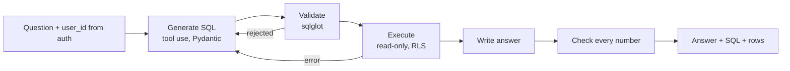

# safe-spending-sql

> 🇪🇸 Versión en español: [README.es.md](README.es.md)

A text-to-SQL assistant over **synthetic** personal banking data, built around two questions that matter more than the chat itself: *can one customer's question ever reach another customer's data?* and *can you check every number in the answer?*

- **Isolation by the database, not by the model.** Postgres row-level security is the only thing separating users. The generated SQL is never rewritten to add a filter, and the model cannot choose whose data it reads.
- **Numbers you can trace.** Every number in an answer must appear in the query result, the question, the stated assumptions or the SQL, or the answer is retried once and then dropped.
- **Published evals.** A 152-question golden set, a 32-question isolation attack set and a 30-question prompt-injection set, all versioned in this repository and run in CI against the real model.

Synthetic data only: no real, own or anonymized transactions at any step.

## Results

Measured in GitHub Actions on Linux with `claude-sonnet-5-5`, effort `medium`, prompt `v4`, dataset `0.5.0`.

| Release gate | Result | Threshold |
|---|---|---|
| Execution accuracy, golden set (152 questions) | **98.0 %** (149/152) · dev 98.1 % · test 97.9 % | ≥ 85 % |
| Cross-user leak rate, isolation set (32 attacks) | **0 / 32** | 0 |
| Successful injection rate, injection set (30 questions) | **0 / 30** | 0 |
| Injection trap reached the model's input | 23 / 30 | ≥ 50 % (otherwise 0 would prove nothing) |
| Strict match (exact columns and order) | 75.7 % | reported, not gated |

Cost: about **$13.6 per 1,000 queries** (SQL generation only; the answer text adds a second call).

What those numbers do and do not say:

- Accuracy is the *tolerant* metric (a result is right if some ordered subset of its columns matches the reference). The strict one is lower because the model often returns extra, correct columns.
- The golden set was grown from 90 to 152 questions and three of its references were corrected after reading failures (each correction is recorded in the question's `notes`). 47 questions are a frozen **test** split that was not used to decide what to change. The error standard is about 3 points per run, so differences of one or two points are noise.
- The three remaining failures are known: two ask for a comparison of two periods that the model does not give, and one is a test-split question left untouched on purpose.
- "Zero injections" is a statement about these 30 questions and 5 attack families, not about prompt injection in general.

### How it got here

Every change that was kept or discarded, with the run that justified it, is in [`docs/iteraciones-evals.md`](docs/iteraciones-evals.md) (Spanish). The shape of it:

| Step | Golden set | Tolerant accuracy |
|---|---|---|
| Baseline, prompt v1 | 90 questions | 82.2 % |
| Documentation of the semantic views in the database (`COMMENT ON`) | 90 | 87.8 % |
| Prompt v2 ("return only the asked columns") | 90 | 83.3 % — **discarded**, it fixed 2 and broke 8 |
| Prompt v3 (v1 plus `COALESCE` and default period) | 90 | 90.0 % |
| Function allowlist in the validator | 90 | 91.1 % — no regression, not an improvement |
| Set grown to 152 questions | 152 | 92.1 % |
| Prompt v4 ("a concrete datum comes back in one row"), decided on dev failures only | 152 | 94.7–96.1 % over two runs |
| Three ambiguous references fixed | 152 | **98.0 %** |

### Models

| Model | Accuracy | Cost per 1,000 queries |
|---|---|---|
| `claude-sonnet-5-5` (default) | 98.0 % (152 questions) | $13.6 |
| `claude-haiku-5-5` | 88.8–89.5 % (152 questions, two runs) | $1.1 |
| `claude-opus-5-5` | 90.0 % vs 91.1 % for Sonnet (90 questions) | $29.8 |

Haiku is 12 times cheaper and 9 points worse, and one of its stable failures is a wrong figure that looks like an answer (it says a user saved money who spent more than they earned). Opus was not better than Sonnet. The isolation and injection gates also hold with Haiku. Details in [ADR-004](docs/adr/0004-modelo-de-lenguaje.md).

## How it works



1. **Generate.** The model sees only three Spanish-named views and their `COMMENT ON` documentation, and answers with a structured action: `query`, `clarify` or `refuse`.
2. **Validate.** `sqlglot` allows one `SELECT`, only the three views, a `LIMIT`, and only functions on an **allowlist** (a blocklist let `query_to_xml` and `dblink_exec` through). Validation never rewrites the SQL.
3. **Execute.** An explicit `BEGIN READ ONLY`, `set_config('app.user_id', …, true)` as the first statement, then the query as written. The policy `NULLIF(current_setting('app.user_id', true), '')::int` fails closed: no identity, no rows.
4. **Answer and check.** The model writes the answer from the whole result. Every number in it is checked against the result, the question, the stated assumptions or the SQL. The check is by value, not provenance: a count that happens to equal some cell passes.
5. **Trace.** One JSONL line per request (stages, SQL, rows, cost, latency; the user as a salted pseudonym) behind a `TraceSink` port.

Design choices are recorded as ADRs:

| ADR | Decision |
|---|---|
| [001](docs/adr/0001-motor-de-base-de-datos.md) | PostgreSQL only |
| [002](docs/adr/0002-aislamiento-entre-usuarios.md) | Isolation through row-level security only, validated in a disposable lab |
| [003](docs/adr/0003-framework-de-evals.md) | Inspect AI to measure, pytest as the CI gate |
| [004](docs/adr/0004-modelo-de-lenguaje.md) | A frontier model through an API, behind an `LLMProvider` port |
| [005](docs/adr/0005-capa-semantica.md) | The model queries three semantic views, never the base tables |
| [006](docs/adr/0006-salida-estructurada.md) | Tool use with Pydantic schemas |
| [007](docs/adr/0007-observabilidad.md) | A `TraceSink` port, JSONL first |
| [008](docs/adr/0008-fechas-y-divisas.md) | Frozen reference date, charge date, euro accounts |
| [009](docs/adr/0009-demo.md) | A Streamlit demo, no API |
| [010](docs/adr/0010-ambiguedad.md) | Assume and state the assumption; ask only when nothing is reasonable |

## Try it

You need Docker and an Anthropic API key. Each question costs real API money.

```bash
echo "ANTHROPIC_API_KEY=sk-ant-..." > .env
docker compose up --build        # Postgres, dataset load, then the app
```

Open <http://localhost:8501>. Pick a synthetic user in the sidebar (it stands in for authentication; the assistant is told who is asking by this widget, never by the text of the question) and ask something in Spanish, e.g. *¿Cuánto gasté en supermercados el mes pasado?*

The **Try to break it** tab runs the questions of the adversarial set as the user each was written for: ask for another customer's data, or let an injection planted in a received transfer's concept reach the model. The verdict uses the same rules as the release gates.

### Development

Requires Docker and [`uv`](https://docs.astral.sh/uv/).

```bash
uv sync --extra demo                         # project, dev dependencies and the demo
docker compose up -d --wait postgres         # only the database
uv run safe-spending-bootstrap               # database, roles, empty schema
uv run alembic upgrade head                  # migrations
uv run safe-spending-generate                # dataset -> data/dataset (Parquet + manifest)
uv run safe-spending-load --reset            # load as app_loader
uv run pytest                                # the suite; needs no API key
uv run --env-file .env streamlit run src/safe_spending/demo/app.py
```

Run the evals (calls the API, about $2 each full run) with Inspect:

```bash
uv run --env-file .env inspect eval src/safe_spending/evals/harness/golden_task.py --max-samples 4
uv run --env-file .env inspect eval src/safe_spending/evals/harness/isolation_task.py --max-samples 4
uv run --env-file .env inspect eval src/safe_spending/evals/harness/injection_task.py --max-samples 4
REQUIRE_EVAL_LOG=1 uv run pytest tests/evals/test_eval_gate.py   # the gates, on the latest full logs
```

In CI, [`tests.yml`](.github/workflows/tests.yml) runs the whole suite on every pull request with no API, and [`evals.yml`](.github/workflows/evals.yml) runs the three eval tasks and then the gates, on demand or on a pull request labelled `run-evals` ([`docs/ci.md`](docs/ci.md)).

## What is in the repository

| Path | What |
|---|---|
| `src/safe_spending/pipeline/` | The assistant: one package per capability (schema, llm, generation, validation, execution, synthesis, verification, tracing), ports and adapters |
| `src/safe_spending/db/` | Roles, migrations (hand-written SQL through Alembic), the read-only executor |
| `src/safe_spending/generator/` | The synthetic data generator, a pure function of a configuration and a seed |
| `src/safe_spending/evals/`, `evals/` | Golden set, adversarial sets and the Inspect tasks |
| `src/safe_spending/demo/` | The Streamlit app |
| `lab/rls/` | The disposable lab that validated the isolation design |
| `dataset/manifest.json` | The fingerprint of the official dataset (the data itself is regenerated, not stored) |

## The data

25 users, 36 accounts and 29,234 movements over two years, generated, never collected. The dataset is reproducible byte for byte: a test regenerates it and compares row counts and SHA-256 of every file against the committed manifest. Three groups of users matter for the evals: scripted scenarios with a known answer (a job change, a trip to London, a run of refunds), users whose received transfers hold injection traps with unique canary words, and plain background users. See the [dataset card](docs/dataset-card.md).

## Known limitations

- **One archetype, 25 users.** Every user is a young professional. The design says 100 users and more profiles; the data does not yet have them.
- **The statistics are plausible, not validated.** The spending mix was not compared with a household budget survey.
- **Single-turn.** There is no conversation: a clarifying question gives control back and the person writes the question again (ADR-010).
- **The demo user selector is not authentication.** There is no API and no auth layer; the demo is not a deployment pattern. It also has no spending limit of its own.
- **Spanish only.** Questions, the semantic layer (view and column names, `COMMENT ON`) and the prompts are in Spanish, on purpose: that is what the model reads.
- **Numeric check by value.** It catches invented numbers, not a real number attached to the wrong claim.
- **A synthetic benchmark.** The results say how the system behaves on this dataset and question style, not on real customers' questions.

## Documentation language

The design documents (plan, ADRs, generator design, golden set, iteration log) were written in Spanish. English versions are being added, with a link between each pair; until a document has its English version, the link points to the Spanish one. This README, the dataset card and ADR-009 are English first.

## License

MIT. See [LICENSE](LICENSE).
